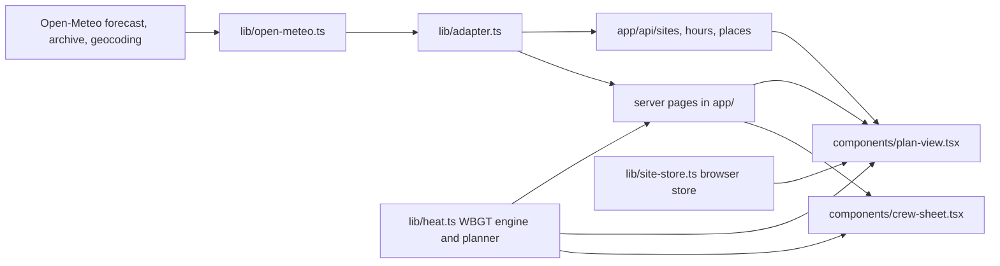

# Calidra

Calidra gives the lead of an outdoor crew tomorrow's in-sun heat stress (WBGT) for every hour, with the minutes of work and rest each hour allows and the shift start that loses the least time. The free tools crew leads use today read the heat index, which is computed for shade, while their crews work in the sun.

**Live:** https://calidra.vercel.app (open it and follow DEMO.md from step 1: the collection on `/`, then the Phoenix row).

The live URL is meant to run with `ADAPTER_MODE=real`. Every site page says in words which data is on screen: a badge reading "Open-Meteo historical archive" or "Open-Meteo forecast" for live hours, or "Source: seed day profile" plus a line starting "Sample data:" when it shows the stored day profile.

## Try it in 60 seconds

1. Open https://calidra.vercel.app. In "Crew sites", press "Stop-work hours" in the sort control: the rows reorder and the matching figure is outlined in every row.
2. Press "Quick look" on the Phoenix row: the row opens in place into a larger plan panel. Press "Open the full plan".
3. Hover or tab across the hour strip: each hour shows air temperature, humidity, sunlight, wind, heat index, sun WBGT and work/rest minutes.
4. Drag "Shift start" from 07:00 to 05:00. The rest counter rolls down and the gold "Best window" badge updates.
5. Press "Crew sheet", then "Español". Same numbers, Spanish words, a QR code back to the same plan.

## The problem

Outdoor workers die from heat every summer, and a large share of those deaths happen in a worker's first days on the job. The OSHA-NIOSH Heat Safety Tool is built on the heat index. OSHA's own guidance says the heat index assumes shade and a light wind, that full sun can push the real load up by as much as 15°F, and that WBGT is the better measure. A small subcontractor with no WBGT meter cannot answer the question that matters at 6 a.m.: how many minutes of break does my crew need each hour this afternoon?

## What Calidra does

1. Pulls 24 hours of temperature, humidity, shortwave radiation, wind, cloud and pressure for the site from Open-Meteo when the deploy runs with `ADAPTER_MODE=real`. No key, no account. Sample mode expands stored day profiles instead and says so on the page.
2. Solves the black globe and natural wet bulb temperatures with an energy balance after Liljegren et al. (2008), iterating each one until it moves less than 0.02 K, and combines them into outdoor WBGT.
3. Runs every hour against the ACGIH curves for the chosen workload (light 180 W to very heavy 520 W) and clothing, and turns the result into work and rest minutes. Veterans use the TLV. Workers new this week use the action limit plus the NIOSH ramp: 20 percent of a normal exposure on day one, 20 percent more each day.
4. Scans every shift start from 04:00 and reports the one with the most productive crew-minutes.
5. Shows the heat index next to WBGT for the same hour, so you can see when a shade reading such as "Caution" or "Extreme caution" means "stop work" in the sun.

Seven of the ten seeded sites replay real heat days (Phoenix on 19 July 2023, Houston, the San Joaquin Valley, Andalusia, Delhi, the Çukurova plain, Miami). Three sit in the southern hemisphere, where it is summer now, on tomorrow's forecast.

## Architecture



Server pages read through `getAdapter()` in `lib/adapter.ts`; client components call the `/api/*` routes. Every outbound call goes through `fetchJson()` in `lib/http.ts` (8 s timeout, one retry for timeouts and 5xx answers) and every answer is checked with a zod schema in `lib/schemas.ts`.

## Quickstart

```bash
npm install
npm run dev     # http://localhost:3000
npm test        # Vitest, offline
npm run proof   # live Open-Meteo calls plus the test run, written into the Proof section
npm run build
```

No keys are needed. `ADAPTER_MODE` (`fake` by default, `real` for live hours) and `NEXT_PUBLIC_SITE_URL` (the address the crew sheet QR points to) are described in `.env.example`. `npm run demo:reset` prints the reset URL `/?demo-reset=1` that clears sites saved in a browser.

## Addresses

| What | Address |
| --- | --- |
| Live app | https://calidra.vercel.app |

## How it uses the required tech

This hackathon has no sponsor SDK. The one hard requirement is a technology project aimed at a real social impact problem; the heavy lifting is the physics engine in `lib/heat.ts`. The three keyless Open-Meteo APIs are called from the server when `ADAPTER_MODE=real`:

| API | Used for | Code |
| --- | --- | --- |
| Forecast | tomorrow and the next 15 days | `fetchHourly()` in `lib/open-meteo.ts` |
| Historical archive | any past day back to 1950 | `fetchHourly()` picks it for dates older than 6 days |
| Geocoding | place search on `/new` | `searchPlaces()` in `lib/open-meteo.ts` |

If a call fails in real mode, the site falls back to its stored day profile, and the site page says in words that it is showing sample data.

## Interface

- `/` is a bento of six unequal cells (claim, picture, call to action, the 15°F sun gap, a live strip for the Phoenix seed, the method) above the crew site collection. Search, workload and weather filters, and the sort control (peak sun WBGT, stop-work hours, rest owed, name) live in the URL. AutoAnimate moves the rows when they reorder.
- "Quick look" opens a row in place: the row's name and figure block carry Motion `layoutId`s and morph into the larger panel. The site page header carries the same ids.
- The hour strip on `/site/[slug]` shows a breakdown for the hour under the pointer or keyboard focus, built from the engine's own output for that hour.
- With reduced motion turned on, every control works the same and nothing animates.

## Crew sheet

On any seeded site, press "Crew sheet". `/site/[slug]/print` prints a one-page work/rest plan for the shift: each hour's sun WBGT, plan, work and rest minutes, the new-worker minutes, the rest the crew owes and the best start window. An English and Spanish toggle (two plain links, so it works with JavaScript off) switches every word and keeps every number. A QR code, made on the server with `qrcode`, opens the same plan with the same settings.

The settings live in the URL (`workload`, `clothing`, `crew`, `newWorkers`, `day`, `start`, `hours`), parsed with zod in `lib/plan-params.ts`. `lib/print-sheet.ts` builds the sheet from `planDay`, `shiftTotals` and `bestStart` with static EN and ES dictionaries.

<!-- PROOF:BEGIN print-sheet -->
Ran on 2026-11-24: lib/print-sheet.ts built the Phoenix sheet (workload=heavy&clothing=workClothes&crew=6&newWorkers=2&day=2&start=5&hours=8) from live archive hours in English and Spanish, 8 shift rows, 1,770 crew-minutes of rest. First row 05:00: "Normal work" / "Trabajo normal". EN: Best window: start at 16:00 (end 00:00) and save 350 crew-minutes of rest. ES: Mejor horario: empezar a las 16:00 (terminar a las 00:00) ahorra 350 minutos por persona de descanso. Same minutes in both languages: yes.
<!-- PROOF:END print-sheet -->

## Proof

Written by `npm run proof` (`scripts/proof.mjs`). Live weather: one archive call for Phoenix on 19 Jul 2023 through `lib/open-meteo.ts`, then the WBGT engine, the heavy-work planner and the heat index mismatch search.

<!-- PROOF:BEGIN live-weather -->
Ran on 2026-11-24: one Open-Meteo archive call for Phoenix (33.4484, -112.0740) on 2023-07-19 returned 24 hours in 266 ms, solved to sun WBGT by lib/heat.ts and planned for heavy work. No hour that day reads heat index Caution or lower while sun WBGT says rest or stop.
<!-- PROOF:END live-weather -->

Demo path: `getHours` timed through `getAdapter()` in real mode for the two demo sites, with the source that came back and the heat index band gap hour from `findBandGap`.

<!-- PROOF:BEGIN demo-path -->
Ran on 2026-11-24 through getAdapter() in real mode, cold (no Next.js cache outside the server): Phoenix 2023-07-19: 24 hours from live archive in 61 ms, band gap at 09:00 (heat index Extreme caution, rest); Cuiabá 2026-11-25: 24 hours from live forecast in 179 ms, band gap at 09:00 (heat index Extreme caution, rest). Every call finished under 5 s.
<!-- PROOF:END demo-path -->

Tests:

<!-- PROOF:BEGIN tests -->
Ran on 2026-11-24 with Vitest: 50 passed, 0 failed, 1 skipped.
<!-- PROOF:END tests -->

The skipped test is the OSHA comparison: `tests/wbgt-reference.json` holds no reference points yet, so the OSHA Outdoor WBGT calculator comparison is not filled in.

### Adapter modes

`ADAPTER_MODE=fake` (the default when unset) serves the seed sites and expands their stored day profiles offline, with a small built-in place list for `/new`. `ADAPTER_MODE=real` calls the Open-Meteo APIs from the server, caches hours with `unstable_cache` per place and date (30 minutes for forecasts, 24 hours for archive days), waits at most 4 s for live hours (`HOURS_BUDGET_MS`), and falls back to the seed profile if a call fails or runs over. `/api/*` errors come back as `{ error: { error, hint } }` with a fixed code (`invalid_input`, `upstream_timeout`, `upstream_error`, `parse_failure`, `not_configured`).

### Persistence

Sites made on `/new` are saved in the visitor's browser (localStorage), through `lib/site-store.ts` only. Limit: the list is not shared across devices or browsers, and clearing site data removes it. Each saved site's slug ends in a hash of its inputs, so saving the same site twice replaces the row. There is no database and no migration.

## Routes

- `/` crew sites, with search, workload and weather filters, and sort, all kept in the URL
- `/site/[slug]` the plan for one site: hours, settings (kept in the URL), shift slider, hour strip with breakdown
- `/site/[slug]/print` the EN/ES crew sheet with a QR code back to the same plan
- `/new` add a site from a place search and a date
- `/about` the method, the thresholds in use, limits and sources
- `/api/sites`, `/api/sites/[slug]`, `/api/hours`, `/api/places` JSON routes, all returning `{ ok, data, error, source }`

## Tech stack

- Next.js 15 (App Router), React 19, TypeScript 5 strict
- Tailwind CSS 4 with shadcn-style primitives in `components/ui/`
- AutoAnimate 0.11 for the collection, Motion 14 for the layout morph, the sort highlight and the rolling rest counter
- zod 3 for API query, URL plan settings and Open-Meteo response validation
- qrcode 1 for the crew sheet QR code, rendered as SVG on the server
- Vitest 3 for the engine, schema, HTTP helper, browser store, URL settings and crew sheet tests
- Open-Meteo Forecast, Historical and Geocoding APIs
- Deployed on Vercel

## Bounties

This hackathon lists no sponsor bounty. All four prizes come from one judging ranking:

| Prize | Award |
| --- | --- |
| First Place | $ 200 in cash |
| Second Place | Runner-up recognition award. |
| Third Place | Runner-up recognition award. |
| Honorable Mention | Runner-up recognition award. |

## What we would build next

- A crew sheet for sites saved in a browser (today only the seeded sites print).
- The OSHA validation table: three reference points entered by hand from the OSHA Outdoor WBGT calculator into `tests/wbgt-reference.json`, checked at ±1°C.
- Shade-aware rest: let the lead mark a shaded rest area and use a lower WBGT for break minutes.
- Shared sites, so a plan made on the lead's phone opens on the foreman's.

## Security

No wallet, no account, no API key, no server write route. See `SECURITY.md`.

## Limits

Calidra is a screening tool. It does not replace on-site WBGT measurement, medical advice or an employer's heat illness prevention program. Weather grids are kilometres wide; a dark roof can run hotter than the model.

## AI use

The Code for Change rules state no policy on AI tools. We used an AI coding assistant (Claude Code) throughout: it drafted most of the code, tests and documents from our specifications, and we reviewed, ran and corrected its output. Product scope, the choice of the WBGT method and the demo flow are our decisions. The physics follows the published equations cited below, not model output.

## License

MIT, see `LICENSE`.

## Credits

Weather data by [Open-Meteo](https://open-meteo.com/) (CC BY 4.0). WBGT method after Liljegren, Carhart, Lawday, Tschopp and Sharp (2008); the code is written from the paper's equations.
